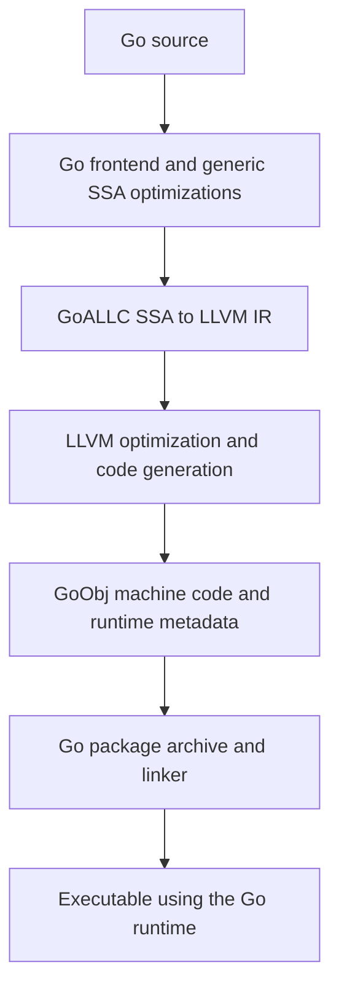

# GoALLC

[](https://github.com/goallc/go/releases)
[](https://github.com/goallc/go/actions/workflows/goallc.yml)
[](LICENSE)

English | [简体中文](README.zh-CN.md)

[Downloads](https://github.com/goallc/go/releases) · [Architecture](GOALLC.md) · [Issues](https://github.com/goallc/go/issues) · [Contributing](CONTRIBUTING.md)

**Go's toolchain and runtime, with an LLVM backend.** GoALLC brings LLVM optimization
and code generation to existing Go projects while retaining Go's frontend,
standard library, runtime, assembler, and linker. The goal is to build existing Go
code and dependencies with the familiar `go build`, `go test`, and `go run` commands.

- **Go compatibility:** preserve goroutines, garbage collection, reflection, cgo,
  and interoperability with Go assembly through Go ABI and runtime metadata support.
- **LLVM optimization:** apply loop optimizations, vectorization, CPU specialization,
  instruction scheduling, and register allocation to Go programs.
- **Experimental SIMD:** support Go 1.27's `simd` and `simd/archsimd` APIs, with
  vector operations represented directly in LLVM IR.

## Get started

[GoALLC 0.1.0](https://github.com/goallc/go/releases/tag/go1.27.3-goallc.0.1.0)
is based on **Go 1.27.3 and LLVM 23.1.4**. Download the SDK and its SHA-256 file for
your platform:

| Platform | SDK | Checksum |
| --- | --- | --- |
| Linux amd64 | [tar.gz](https://github.com/goallc/go/releases/download/go1.27.3-goallc.0.1.0/go1.27.3-goallc.0.1.0.linux-amd64.tar.gz) | [SHA-256](https://github.com/goallc/go/releases/download/go1.27.3-goallc.0.1.0/go1.27.3-goallc.0.1.0.linux-amd64.tar.gz.sha256) |
| Linux arm64 | [tar.gz](https://github.com/goallc/go/releases/download/go1.27.3-goallc.0.1.0/go1.27.3-goallc.0.1.0.linux-arm64.tar.gz) | [SHA-256](https://github.com/goallc/go/releases/download/go1.27.3-goallc.0.1.0/go1.27.3-goallc.0.1.0.linux-arm64.tar.gz.sha256) |
| macOS arm64 | [tar.gz](https://github.com/goallc/go/releases/download/go1.27.3-goallc.0.1.0/go1.27.3-goallc.0.1.0.darwin-arm64.tar.gz) | [SHA-256](https://github.com/goallc/go/releases/download/go1.27.3-goallc.0.1.0/go1.27.3-goallc.0.1.0.darwin-arm64.tar.gz.sha256) |
| Windows amd64 | [zip](https://github.com/goallc/go/releases/download/go1.27.3-goallc.0.1.0/go1.27.3-goallc.0.1.0.windows-amd64.zip) | [SHA-256](https://github.com/goallc/go/releases/download/go1.27.3-goallc.0.1.0/go1.27.3-goallc.0.1.0.windows-amd64.zip.sha256) |

Extract the archive and add its `go/bin` directory to `PATH`. For example, on
Linux or macOS, after extracting into `$HOME/sdk/goallc-0.1.0`:

```sh
export PATH="$HOME/sdk/goallc-0.1.0/go/bin:$PATH"
go version
# go version go1.27.3-goallc.0.1.0 <os>/<arch>

# In an existing Go project:
go build ./...
go test ./...
go run .
```

On Windows, add the extracted `go\bin` directory to `PATH` and use the same Go
commands. The SDK enables LLVM by default and includes its compiler dependencies;
building pure Go projects requires no separate LLVM or C++ installation. cgo
requires a C toolchain for the target platform.

## How it works



GoALLC enters LLVM after Go's generic SSA optimizations and before target-specific
lowering. Normal package compilation runs LLVM in the compiler process. LLVM
handles instruction selection, register allocation, and frame layout, and emits
GoObj data that rejoins Go's archive and linking flow.

GoALLC's LLVM extensions implement Go calling conventions and stack growth.
Go-specific passes handle write barriers, statepoints, and pointer liveness;
late code generation produces stack maps and metadata for GC, stack copying,
preemption, traceback, and debugging. This keeps optimized machine code connected
to the existing Go runtime.

See the [SSA pipeline](doc/goallc-llvm-pipeline.md),
[GoObj integration](doc/goallc-llvm-goobj.md), and
[GoALLC LLVM passes](src/cmd/llvmplugin/README.md) for implementation details.

## Compatibility

GoALLC passes the vast majority of Go's official tests. The 0.1.0
[release validation](https://github.com/goallc/go/actions/runs/42442773313)
passed all 16 `dist test` shards across the four SDK platforms, along with SDK
relocation and cgo checks, using short mode and the release's known exclusions.

Some differences reflect stronger optimization: tail-recursion elimination can
remove stack frames expected by traceback tests. Other exclusions cover traceback
metadata, native-backend-specific assembly and diagnostics, and remaining compiler
diagnostics work. See the [known differences](test/llvm_known_failures.json).

## SIMD and optimization

Enable Go's experimental SIMD APIs with `GOEXPERIMENT=simd`, for example:

```sh
GOEXPERIMENT=simd go test ./...
```

GoALLC follows the Go 1.27 SIMD API, including portable `simd` and the amd64
`simd/archsimd` operations on 128-, 256-, and 512-bit vectors. Explicit vector
operations participate in LLVM's constant folding, instruction combining, and
target instruction selection. LLVM's loop and SLP vectorizers also optimize
eligible scalar code, extending vectorization beyond explicit SIMD calls.

CPU specialization uses LLVM IR function versions and runtime dispatch to select
an implementation for the current processor. Architecture-specific SIMD still
requires the appropriate CPU capabilities; see the
[SIMD CPU contracts](doc/goallc-llvm-pipeline.md#simd-cpu-preconditions).

## Performance

GoALLC 0.1.0 was compared with official Go 1.27.3 on Linux amd64 with an Intel Core
Ultra 9 185H: 92 cases, 12 interleaved rounds per toolchain, equal iteration counts
per case, CPU 1 affinity, `GOMAXPROCS=1`, `GOAMD64=v1`, and PGO disabled.
Selected median times per operation:

| Benchmark | Go 1.27.3 | GoALLC 0.1.0 | Time reduction |
| --- | ---: | ---: | ---: |
| Gonum Min, 32 elements | 43.695 ns | 23.495 ns | 46.2% |
| Bitset Count, dense | 385.850 ns | 268.950 ns | 30.3% |
| EqualFold, Unicode prefix | 64.075 ns | 52.735 ns | 17.7% |
| Flate compression, Newton 10 KB | 78.943 µs | 67.008 µs | 15.1% |

Across all 92 cases, **23 were faster, 22 slower, and 47 had small or uncertain
differences**, using a 5% effect threshold and a paired sign test with Holm
correction (`p ≤ 0.05`). Performance depends on the workload and CPU; benchmark
your own application. The [full results](doc/benchmarks/goallc-0.1.0/comparison-cases.csv),
[2,208 observations](doc/benchmarks/goallc-0.1.0/comparison-samples.csv), and
[test configuration](doc/benchmarks/goallc-0.1.0/comparison-config.json)
include the slower cases as well as the gains.

## Contributing upstream

Developing GoALLC has also led to fixes in Go and LLVM. Examples already merged
upstream include:

| Project | Fix | Change |
| --- | --- | --- |
| Go | Preserve floating-point SIMD Min/Max operand order for NaN and signed zero | [CL 831764](https://go-review.googlesource.com/c/go/+/831764) |
| Go | Correct alternating fused multiply-add lane parity | [CL 832004](https://go-review.googlesource.com/c/go/+/832004) |
| Go | Fix carryless multiplication feature checks and register constraints | [CL 831804](https://go-review.googlesource.com/c/go/+/831804) |
| LLVM | Order fixed stack objects by offset during instruction scheduling | [PR #219669](https://github.com/llvm/llvm-project/pull/219669) |
| LLVM | Avoid unnecessary stack realignment when SROA rewrites allocas | [PR #222967](https://github.com/llvm/llvm-project/pull/222967) |

## Development

For source builds, use the [GoALLC LLVM fork](https://github.com/goallc/llvm-project)
and follow the [build guide (Chinese)](doc/goallc-build.md). Compatibility,
debug information, workload performance, and LTO integration remain active areas
of development.

Report bugs and performance cases in [GoALLC issues](https://github.com/goallc/go/issues),
including the toolchain version, OS/architecture, and a reproducer. Pull requests
are welcome in this repository.

GoALLC builds on the work of the Go and LLVM communities. Unless otherwise noted,
the Go source files are distributed under the BSD-style [LICENSE](LICENSE).
