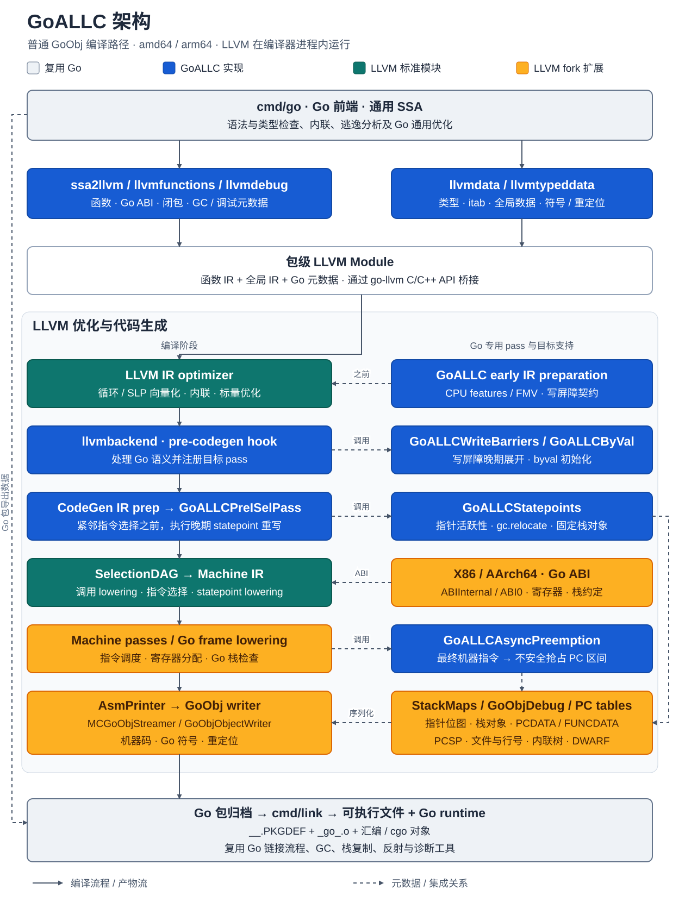

# GoALLC

[](https://github.com/goallc/go/releases)
[](https://github.com/goallc/go/actions/workflows/goallc.yml)
[](LICENSE)

[English](README.md) | 简体中文

[下载](https://github.com/goallc/go/releases) · [架构](GOALLC.md) · [问题反馈](https://github.com/goallc/go/issues) · [参与开发](CONTRIBUTING.zh-CN.md)

**保留 Go 工具链与运行时，接入 LLVM 后端。** GoALLC 为现有 Go 项目引入 LLVM
的优化与代码生成能力，复用 Go 前端、标准库、运行时、汇编器和链接器。
目标是让已有代码和依赖继续使用熟悉的 `go build`、`go test`、`go run` 命令。

- **Go 兼容性：** 通过 Go ABI 和运行时元数据支持，保留 goroutine、GC、反射、cgo
  以及与 Go 汇编的互操作。
- **LLVM 优化：** 将循环优化、向量化、CPU 特化、指令调度和寄存器分配用于 Go 程序。
- **实验性 SIMD：** 支持 Go 1.27 的 `simd` 和 `simd/archsimd` API，
  将向量操作直接表示为 LLVM IR。

## 快速开始

[GoALLC 0.1.0](https://github.com/goallc/go/releases/tag/go1.27.3-goallc.0.1.0)
基于 **Go 1.27.3 和 LLVM 23.1.4**。下载对应平台的 SDK 和 SHA-256 校验文件：

| 平台 | SDK | 校验文件 |
| --- | --- | --- |
| Linux amd64 | [tar.gz](https://github.com/goallc/go/releases/download/go1.27.3-goallc.0.1.0/go1.27.3-goallc.0.1.0.linux-amd64.tar.gz) | [SHA-256](https://github.com/goallc/go/releases/download/go1.27.3-goallc.0.1.0/go1.27.3-goallc.0.1.0.linux-amd64.tar.gz.sha256) |
| Linux arm64 | [tar.gz](https://github.com/goallc/go/releases/download/go1.27.3-goallc.0.1.0/go1.27.3-goallc.0.1.0.linux-arm64.tar.gz) | [SHA-256](https://github.com/goallc/go/releases/download/go1.27.3-goallc.0.1.0/go1.27.3-goallc.0.1.0.linux-arm64.tar.gz.sha256) |
| macOS arm64 | [tar.gz](https://github.com/goallc/go/releases/download/go1.27.3-goallc.0.1.0/go1.27.3-goallc.0.1.0.darwin-arm64.tar.gz) | [SHA-256](https://github.com/goallc/go/releases/download/go1.27.3-goallc.0.1.0/go1.27.3-goallc.0.1.0.darwin-arm64.tar.gz.sha256) |
| Windows amd64 | [zip](https://github.com/goallc/go/releases/download/go1.27.3-goallc.0.1.0/go1.27.3-goallc.0.1.0.windows-amd64.zip) | [SHA-256](https://github.com/goallc/go/releases/download/go1.27.3-goallc.0.1.0/go1.27.3-goallc.0.1.0.windows-amd64.zip.sha256) |

解压后，将其中的 `go/bin` 加入 `PATH`。例如在 Linux 或 macOS 上，
解压到 `$HOME/sdk/goallc-0.1.0` 后执行：

```sh
export PATH="$HOME/sdk/goallc-0.1.0/go/bin:$PATH"
go version
# go version go1.27.3-goallc.0.1.0 <os>/<arch>

# 在已有 Go 项目中执行：
go build ./...
go test ./...
go run .
```

Windows 用户将解压后的 `go\bin` 加入 `PATH`，使用相同的 Go 命令。
SDK 默认启用 LLVM，并集成编译器所需依赖；编译纯 Go 项目无需另行安装 LLVM
或 C++ 工具链。使用 cgo 时，需要目标平台对应的 C 工具链。

## 工作原理

[](doc/images/goallc-architecture.zh-CN.svg)

蓝色为 GoALLC 实现，橙色为 LLVM fork 扩展，青绿色为 LLVM 标准模块；复用 Go 的部分以灰色合并展示。点击图片可放大查看。

GoALLC 在 Go 通用 SSA 优化之后、目标架构 lowering 之前接入 LLVM。
普通包编译在编译器进程内运行 LLVM，由 LLVM 负责指令选择、寄存器分配和栈帧布局，
输出 GoObj 数据，再接回 Go 的归档与链接流程。

GoALLC 的 LLVM 扩展实现 Go 调用约定与栈增长支持。Go 专用 pass 处理写屏障、
statepoint 和指针活跃性，后期代码生成产出 GC、栈复制、抢占、栈回溯和调试所需的
栈图与元数据，使优化后的机器码与现有 Go 运行时保持衔接。

实现细节见 [SSA pipeline](doc/goallc-llvm-pipeline.md)、
[GoObj 集成](doc/goallc-llvm-goobj.md)和
[GoALLC LLVM pass](src/cmd/llvmplugin/README.md)。

## 兼容性

GoALLC 已能通过 Go 官方测试中的绝大多数用例。0.1.0 的
[发布验证](https://github.com/goallc/go/actions/runs/42442773313)在四个 SDK 平台上
通过了全部 16 个 `dist test` 分组，以及 SDK 重定位和 cgo 检查；
这轮验证使用 short 模式，并按版本清单排除了已知差异。

部分差异来自更积极的优化，例如尾递归消除会移除栈回溯测试预期的递归栈帧。
其他排除项涉及栈回溯元数据、原生后端专属的汇编与诊断输出，以及待完善的编译诊断。
具体记录见[已知差异清单](test/llvm_known_failures.json)。

## SIMD 与优化

通过 `GOEXPERIMENT=simd` 启用 Go 的实验性 SIMD API，例如：

```sh
GOEXPERIMENT=simd go test ./...
```

GoALLC 跟进 Go 1.27 的 SIMD API，包括可移植的 `simd`，以及 amd64 上
`simd/archsimd` 的 128、256、512 位向量操作。显式向量操作可以参与 LLVM 的常量折叠、
指令合并和目标指令选择；LLVM 的循环与 SLP 向量化器也会优化满足条件的标量代码，
将向量化能力扩展到显式 SIMD 调用之外。

CPU 特化通过 LLVM IR 函数多版本和运行时分派，选择适合当前处理器的实现。
架构专属 SIMD 操作仍需满足相应的 CPU 能力要求，详见
[SIMD CPU 约定](doc/goallc-llvm-pipeline.md#simd-cpu-preconditions)。

## 性能

GoALLC 0.1.0 与官方 Go 1.27.3 在 Linux amd64、Intel Core Ultra 9 185H 上进行了对比：
92 个用例，两组各交错运行 12 轮，同一用例使用相同迭代次数，固定 CPU 1，
`GOMAXPROCS=1`、`GOAMD64=v1`，关闭 PGO。部分用例的每次操作耗时中位数如下：

| 用例 | Go 1.27.3 | GoALLC 0.1.0 | 耗时降低 |
| --- | ---: | ---: | ---: |
| Gonum Min，32 元素 | 43.695 ns | 23.495 ns | 46.2% |
| Bitset Count，稠密集合 | 385.850 ns | 268.950 ns | 30.3% |
| EqualFold，Unicode 前缀 | 64.075 ns | 52.735 ns | 17.7% |
| Flate 压缩，Newton 10 KB | 78.943 µs | 67.008 µs | 15.1% |

全部 92 个用例中，**23 个更快、22 个更慢、47 个差异较小或统计证据不足**。
判定采用 5% 的差异门槛，以及经过 Holm 校正的配对符号检验（`p ≤ 0.05`）。
性能随工作负载和 CPU 而变化，建议实测自己的应用。
[完整结果](doc/benchmarks/goallc-0.1.0/comparison-cases.csv)、
[2,208 条观测](doc/benchmarks/goallc-0.1.0/comparison-samples.csv)和
[测试配置](doc/benchmarks/goallc-0.1.0/comparison-config.json)
同时保留了更快和更慢的用例。

## 上游贡献

开发 GoALLC 的过程中，我们也向 Go 和 LLVM 提交了修复。以下是已经合入上游的部分工作：

| 项目 | 修复 | 上游记录 |
| --- | --- | --- |
| Go | 保留浮点 SIMD Min/Max 在 NaN 和正负零情况下的操作数顺序 | [CL 831764](https://go-review.googlesource.com/c/go/+/831764) |
| Go | 修正交替融合乘加的奇偶通道映射 | [CL 832004](https://go-review.googlesource.com/c/go/+/832004) |
| Go | 修正无进位乘法的 CPU 特性检查与寄存器约束 | [CL 831804](https://go-review.googlesource.com/c/go/+/831804) |
| LLVM | 机器指令调度时按实际偏移排序固定栈对象 | [PR #219669](https://github.com/llvm/llvm-project/pull/219669) |
| LLVM | 避免 SROA 重写 alloca 时引入不必要的栈重对齐 | [PR #222967](https://github.com/llvm/llvm-project/pull/222967) |

## 参与开发

从源码构建时，请使用 [GoALLC LLVM 分支仓库](https://github.com/goallc/llvm-project)，
并参考[构建指南](doc/goallc-build.md)。兼容性、调试信息、实际工作负载的性能和 LTO
集成是当前持续推进的方向。

欢迎通过 [GoALLC issue](https://github.com/goallc/go/issues)反馈问题与性能用例，
附上工具链版本、操作系统与架构，以及复现方法；也欢迎向本仓库提交 PR。

GoALLC 建立在 Go 与 LLVM 社区的工作之上。除另有说明外，Go 源文件遵循
BSD 风格的 [LICENSE](LICENSE)。
